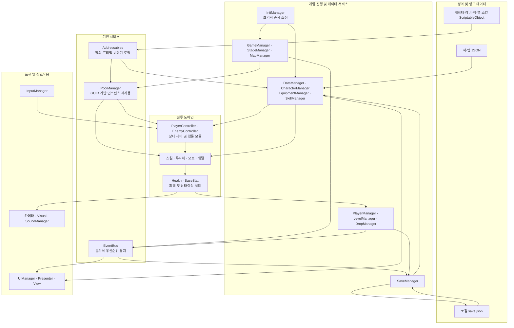
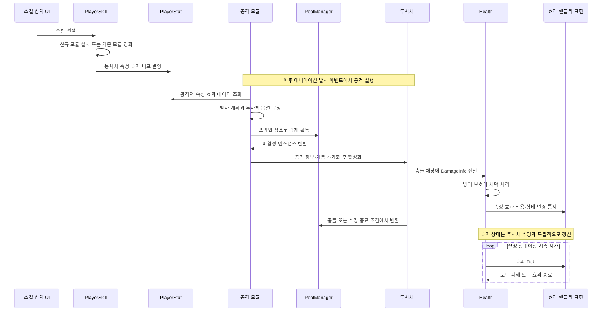

# Archery 시스템 아키텍처 및 구현 세부내용

## 1. 프로젝트 개요와 분석 범위

### 1.1. 프로젝트 개요

Archery는 Unity 기반의 3D 캐주얼 액션 로그라이트 게임이다. 플레이어는 이동을 통해 적의 공격을 회피하고, 정지 상태에서 자동 공격을 수행한다. 적을 처치하여 경험치와 골드를 획득하고, 레벨업 시 제시되는 스킬을 선택함으로써 해당 플레이 회차의 전투 능력을 구성한다. 로비에서는 캐릭터와 장비의 구매·선택·강화를 수행하며, 이러한 영구 성장 정보는 플레이 회차의 임시 성장 정보와 분리하여 관리한다.

시스템 설계의 핵심 목표는 다음과 같다.

- **행동과 데이터의 분리:** 캐릭터·적·맵·스킬·장비의 정의와 실행 로직을 분리하여 콘텐츠 조정의 범위를 제한함.
- **반복적인 전투 객체의 재사용:** 적, 투사체, 드롭 아이템, 효과 객체 및 맵 프리팹을 풀에서 재사용함.
- **게임 진행의 명시적 제어:** 스테이지 상태, 전투 개체 상태, UI 모달 상태를 구분하여 전환 책임을 관리함.
- **영구 성장과 회차 성장의 분리:** 구매·장착·강화 정보는 보존하고, 회차별 경험치·스킬·버프는 별도 수명으로 관리함.
- **변경 통지의 분리:** 전역 이벤트와 개체별 이벤트를 활용하여 게임 진행, UI, 저장 및 시각 효과 사이의 연결을 구성함.

### 1.2. 분석 범위와 기술 기반

본 문서는 작성 시점의 게임 스크립트, ScriptableObject 정의, 관련 설정 및 에셋 참조, 에디터 저작 도구와 사운드 생성 도구에 대한 정적 분석을 기반으로 한다. 외부 에셋에 포함된 데모·유틸리티 코드는 자체 게임 시스템과 구분하였다. 실제 실행으로 측정하지 않은 프레임 속도, 메모리 절감량 및 로딩 시간은 구현 성과로 제시하지 않는다.

| 구분 | 적용 기술과 역할 |
|---|---|
| 게임 엔진 | Unity 6, 프로젝트 에디터 버전 `6000.0.62f1` |
| 구현 언어와 실행 모델 | C#, `MonoBehaviour` 컴포넌트와 Unity 생명주기 |
| 렌더링 및 물리 | URP, 3D Rigidbody·Collider, Animator 및 ParticleSystem |
| 입력 | Unity Input System의 이동 입력과 일부 `KeyCode` 기반 메뉴·진입 입력을 병행 |
| 비동기 처리 | Unity `Awaitable`, Addressables 작업의 `Task`, 객체 파괴 시점의 취소 토큰 |
| 리소스 관리 | Addressables의 라벨 기반 정의 로딩과 AssetReference 기반 프리팹 로딩 |
| 데이터 및 저장 | ScriptableObject, TextAsset JSON, Newtonsoft.Json, 로컬 저장 파일 |
| UI | Unity UI와 TextMesh Pro, Presenter와 View의 역할 분리 |

패키지 설치 여부와 실제 시스템 구현 여부는 별개이다. 따라서 설치된 Entities 패키지를 근거로 ECS 전투 시스템이 구현되었다고 해석하지 않으며, 외부 에셋의 Visitor 예제 역시 본 게임의 핵심 설계 패턴으로 분류하지 않는다.

## 2. 전체 시스템 아키텍처

### 2.1. 논리적 계층 구성

본 프로젝트는 컴포넌트 기반 게임 객체와 책임별 매니저를 결합한 구조이다. 논리적으로는 표현, 게임 진행 서비스, 전투 도메인, 데이터 및 기반 서비스 영역으로 구분할 수 있다. 다만 이러한 구분은 이해를 위한 책임 구획이며, 모든 의존성이 인터페이스로 역전된 엄격한 계층형 아키텍처를 의미하지는 않는다. 실제 구현에서는 매니저와 게임 객체가 Singleton 참조를 통해 직접 협력하는 경로도 존재한다.

그림 1. Archery의 책임 영역과 주요 데이터·통지 연결 구조. 화살표는 대표적인 의존 또는 전달 경로이며, 개별 호출의 실행 순서나 전체 호출 관계를 모두 표현한 것은 아니다.

### 2.2. 주요 설계 패턴

| 패턴 또는 설계 기법 | 적용 영역 | 설계상 역할 |
|---|---|---|
| Singleton | 책임별 매니저와 일부 제어 컴포넌트 | 공통 서비스와 현재 개체에 대한 접근 지점 제공 |
| 상태 기반 제어와 State 패턴 | 플레이어 상태, 적 행동, 스테이지 진행 | 현재 상황에 따라 실행 행동과 허용 전환을 구분 |
| Strategy | `IEffectHandler`, 적의 이동·공격 모듈 | 효과 또는 행동 알고리즘을 교체·조합 |
| Factory와 Registry | `EnemyBehaviorFactory` | 적의 태그와 설정에 따라 필요한 행동 컴포넌트 구성 |
| Observer / Publish–Subscribe | EventBus, Health 이벤트 | 상태 변경 통지와 후속 처리의 연결 분리 |
| MVP 지향 역할 분리 | 로비 탭, 스킬 선택, 결과 및 일시정지 UI | 사용자 조작·표시와 서비스 호출 책임을 구분 |
| Object Pool | PoolManager와 SceneObject 계열 | 반복 객체의 생성·파괴 대신 비활성 인스턴스 재사용 |
| 데이터 주도 구성 | ScriptableObject와 JSON | 콘텐츠 정의, 밸런스 값, 리소스 참조의 외부화 |
| 리플렉션 기반 모듈 연결 | SkillDefinition | 정의 에셋에 지정된 타입을 실제 스킬 컴포넌트로 연결 |
| 컴포넌트 조합 | 플레이어·적의 이동, 공격, 피격 및 시각 요소 | 단일 객체 안에서 기능별 책임을 분리 |

플레이어는 상태별 독립 객체를 교체하는 방식이 아니라 상태 열거형과 기능 컴포넌트가 협력하는 방식이다. 반면 적은 상태별 진입·종료·갱신 동작을 행동 모듈에 위임하고, 스테이지는 상태와 명령의 전이 테이블을 사용한다. 세 구조를 동일한 구현 형태의 FSM으로 설명하지 않는 것이 중요하다.

## 3. Core Managers와 초기화·이벤트 조정 시스템

### 3.1. 시스템 개요 및 핵심 역할

Core Managers는 개별 게임 객체가 공통 데이터, 씬 진행, 보상, UI 및 리소스 관리를 직접 수행하지 않도록 책임을 분배하는 서비스 집합이다. 전역적으로 유지해야 하는 서비스에는 Singleton과 `DontDestroyOnLoad`를 적용하고, 스테이지 제어나 카메라처럼 씬에 종속되는 책임은 별도 컴포넌트로 운영한다.

| 책임 영역 | 주요 관리자 |
|---|---|
| 초기화와 씬 진행 | InitManager, GameManager, StageManager |
| 정의와 콘텐츠 선택 | DataManager, MapManager, CharacterManager, EquipmentManager, SkillManager |
| 전투 개체 및 특수 공격 | EnemyManager, OrbManager, BarrelManager |
| 자원·표현 서비스 | PoolManager, InputManager, UIManager, SoundManager |
| 성장과 영속화 | PlayerManager, LevelManager, DropManager, SaveManager |

모든 Singleton 컴포넌트가 자체적으로 영구 객체인 것은 아니다. 예를 들어 StageManager와 인게임 카메라는 씬별 책임을 가지며, 컴포넌트가 속한 부모 객체의 수명도 최종 생명주기에 영향을 준다.

### 3.2. 주요 구성 요소 및 동작 흐름

초기화는 Loading 씬의 InitManager가 순서를 조정한다. JSON과 플레이어 데이터를 준비한 후 맵, 캐릭터, 장비, 오브, 배럴, 스킬 정의를 순차적으로 로드하고, 로비의 맵과 캐릭터 미리보기 객체를 준비한다. 초기화 완료 후 진입 입력을 통해 로비로 이동한다.

- **데이터 준비:** DataManager 초기화 → 저장 정보 또는 기본값으로 PlayerData 구성.
- **정의 준비:** 맵 → 캐릭터 → 장비 → 오브 → 배럴 → 스킬의 비동기 로딩.
- **로비 준비:** 로비 맵과 캐릭터 미리보기 초기화 → 진행 상황 표시 → 로비 진입 허용.
- **이벤트 조정:** 전투 시작·클리어·레벨업·사망·로비 전환 등의 사건을 EventBus로 통지.
- **처리 순서 관리:** EventBus는 우선순위가 작은 구독자부터 현재 호출 흐름에서 동기적으로 실행하며, 발행 시 구독 목록의 스냅샷을 사용함.

EventBus의 전역 이벤트는 별도의 데이터 페이로드 없이 사건 종류를 전달한다. 수신자는 필요한 정보를 해당 매니저에서 조회한다. 이는 객체 간 직접 호출을 일부 줄이지만, 매니저 상태와 이벤트 처리 순서에 대한 의존성까지 제거하는 구조는 아니다.

### 3.3. 확장성 및 유지보수성

새 서비스는 고유 책임을 부여하고 초기화 단계와 이벤트 연결을 명시하여 추가할 수 있다. 이벤트 구독과 해제의 대칭성, 초기화 선행 조건 및 객체 수명을 함께 관리해야 한다. 또한 초기화 코드가 모든 전투 풀을 일괄 예열하는 것은 아니며, 실제 프리팹 준비는 로비 준비·맵 프리로드·객체 요청 단계에서 지연 수행된다.

구현 근거: [InitManager](Assets/Scripts/Managers/InitManager.cs), [GameManager](Assets/Scripts/Managers/GameManager.cs), [EventBus](Assets/Scripts/Utils/EventBus.cs).

## 4. 데이터 모델과 다층 스탯 시스템

### 4.1. 시스템 개요 및 핵심 역할

데이터 모델은 콘텐츠의 정적 정의, 현재 플레이어의 영구 성장 상태, 전투 객체의 실행 상태를 구분한다. 정적 정의를 런타임 상태와 분리함으로써 동일한 프리팹과 행동 로직을 서로 다른 밸런스·외형·속성 조합으로 활용한다.

| 데이터 종류 | 주요 역할 |
|---|---|
| CharacterIdentity / EquipmentIdentity | 기본 능력치, 레벨 성장, 효과 성장, 구매·강화 조건 및 표시 정보 |
| EnemyIdentity / EnemyBrain / ModuleData | 적 프리팹·외형·태그와 행동 모듈·상태 전환 설정 |
| MapScriptable | 일반·보스·로비 맵 프리팹 및 적 Identity의 연결 |
| SkillDefinition / OrbScriptable / BarrelScriptable | 스킬의 등장·설치 조건과 특수 공격 리소스 정의 |
| EnemyData / MapData JSON | 적 기본 수치, 스테이지 성장, 맵별 배율·적 수·보상 및 효과 설정 |
| PlayerData / SaveData | 소유·장착·영구 레벨·골드 등 실행 상태와 저장 스냅샷 |
| PlayerStat / EnemyStat / Health | 현재 전투에서 사용하는 능력치·체력·효과 상태 |

### 4.2. 주요 구성 요소 및 동작 흐름

적과 맵의 JSON은 Inspector에 연결된 TextAsset으로 읽고 Newtonsoft.Json으로 역직렬화한다. 맵 JSON과 MapScriptable은 `mapId`로 결합하며, 적 데이터는 이름과 태그 조합을 통해 식별한다. 따라서 설정 파일이 프로젝트에 존재한다는 사실만으로 실행 데이터가 자동 교체되는 것은 아니며, 참조와 식별자 연결이 필요하다.

플레이어 스탯은 다음 세 계층의 합성으로 구성된다.

- **Base:** 캐릭터의 기본 정의에 해당 캐릭터의 영구 레벨 성장치를 적용한 값.
- **Equipment:** 장착한 무기·방어구·신발의 종류별 레벨에 따른 보정값.
- **InGameBuff:** 해당 회차에서 획득한 스킬이 적용한 임시 보정값.

최종 일반 능력치는 `Base + Equipment + InGameBuff`로 계산하며, 공격 속성은 각 계층의 비트 플래그를 결합한다. 효과 데이터의 임시 보정은 속성과 스킬 출처별로 보관하여 동일 스킬의 갱신과 서로 다른 스킬의 합성을 구분한다. 효과 지속 시간·강도·도트 피해는 합산하되, 틱 간격은 일반 능력치와 동일한 단순 합산 규칙을 사용하지 않는다.

적은 공통 BaseStat 계약을 사용하되 플레이어의 장비 계층을 그대로 적용하지 않는다. EnemyStatUtil이 적 기본 데이터, 맵 배율 및 스테이지 성장 배율을 결합하고, 맵의 효과 설정을 EnemyEffectCache를 통해 주입한다.

### 4.3. 확장성 및 유지보수성

기존 능력치 범위의 밸런스 조정은 Identity·JSON·성장 데이터 변경으로 수행할 수 있다. 새로운 능력치 자체를 추가하는 경우에는 공통 스탯 계약, 플레이어 계층 합산, 장비 적용, UI 표시 및 저장 필요 여부를 함께 검토해야 한다. 따라서 콘텐츠 추가와 데이터 스키마 확장은 서로 다른 변경 범위로 구분된다.

구현 근거: [PlayerStat](Assets/Scripts/Stats/PlayerStat.cs), [BaseStat](Assets/Scripts/Stats/BaseStat.cs), [EnemyStatUtil](Assets/Scripts/Enemy/EnemyStatUtil.cs), [EffectData](Assets/Scripts/Stats/EffectData.cs), [DataManager](Assets/Scripts/Managers/DataManager.cs).

## 5. Addressables 비동기 리소스 관리와 오브젝트 풀링

### 5.1. 시스템 개요 및 핵심 역할

리소스 시스템은 정의 에셋을 준비하는 단계와 전투 객체의 인스턴스를 확보하는 단계를 분리한다. 정의는 라벨 단위로 로드하여 매니저의 사전에 캐시하고, 프리팹은 AssetReference의 GUID를 기준으로 PoolManager에서 관리한다.

풀링은 반복 객체를 요청할 때마다 새로 생성·파괴하는 비용을 줄이기 위한 구조이다. 다만 이 구조만으로 프레임 유지나 메모리 절감량을 정량적으로 보장하지는 않는다.

### 5.2. 주요 구성 요소 및 동작 흐름

- **정의 로딩:** `map_config`, `character_identity`, `equipment_identity`, `skill_config`, `orb_config`, `barrel_config` 등의 라벨로 정의를 로드하고 식별자·속성별 사전에 저장함.
- **프리팹 로딩:** 최초 GUID 요청 시 Addressables 로드 핸들을 생성하여 풀과 함께 보관함. 같은 GUID의 동시 요청은 기존 핸들의 작업을 공유함.
- **인스턴스 획득:** 비활성 객체가 있으면 즉시 반환하고, 없으면 로드된 프리팹으로 인스턴스를 생성함. 반환받은 객체는 호출자가 초기화한 뒤 활성화함.
- **재사용 초기화:** 투사체의 타격 기록·스킬 옵션, 적의 행동 상태·체력·애니메이션, 수집물의 획득 상태 등을 개체별 초기화 과정에서 정리함.
- **반환과 정리:** 사용 종료 시 비활성화하여 원래 풀로 반환함. 풀 전체 삭제 시 보유 인스턴스를 파괴하고 프리팹 핸들을 Release함.

PoolManager의 기본 예열 메서드는 5개를 생성하며, 일반 비동기 획득의 풀이 비어 있는 경우에는 요청 객체 외에 기본 4개를 추가로 준비한다. 이는 상한이 고정된 용량 정책이 아니며 호출별 조정이 가능하다. 동일 GUID 로딩 공유 역시 Unity의 일반적인 메인 스레드 호출 흐름을 전제로 하며 범용 멀티스레드 동기화 장치와는 다르다.

비동기 경로에는 파괴 취소 토큰을 확인하는 지점이 있다. 이는 객체 파괴 후 후속 처리를 중단하는 보호이며, Addressables의 내부 로드 작업 자체를 즉시 취소한다는 의미는 아니다. 또한 정의 핸들의 소유·Release 시점은 해당 매니저별로 관리되므로 프리팹 풀의 수명 관리와 구분해야 한다.

### 5.3. 확장성 및 유지보수성

새 프리팹은 AssetReference를 통해 동일한 풀 서비스를 사용할 수 있다. 재사용 객체에는 초기화·비활성화·이벤트 해제 규칙을 적용하여 이전 사용 상태가 다음 사용으로 전이되지 않도록 해야 한다.

모든 객체가 풀링되는 것은 아니다. 예를 들어 GroundZoneSkill은 일반 Instantiate를 사용하고 GroundZone은 수명 종료 시 Destroy를 수행한다. 따라서 새 객체를 추가할 때에는 풀 재사용형인지 단기 생성·파괴형인지 먼저 결정하고 일관된 종료 경로를 제공해야 한다.

구현 근거: [PoolManager](Assets/Scripts/Managers/PoolManager.cs), [SkillManager](Assets/Scripts/Managers/SkillManager.cs), [SceneObject](Assets/Scripts/Objects/SceneObject.cs), [GroundZoneSkill](<Assets/Scripts/Players/Skill Module/GroundZoneSkill.cs>).

## 6. 맵·스테이지 진행 및 적 배치 시스템

### 6.1. 시스템 개요 및 핵심 역할

맵 시스템은 공간 프리팹·적 구성·성장 설정을 관리하고, 스테이지 시스템은 전투·클리어·다음 공간 준비의 순서를 제어한다. 미리 제작된 맵을 데이터에 따라 선택·배치하는 구조이며, 이를 지형 전체를 절차적으로 생성하는 시스템으로 해석하지 않는다.

### 6.2. 주요 구성 요소 및 동작 흐름

StageManager는 상태와 명령의 조합을 전이 테이블로 관리한다.

- `Loading + LoadingComplete → Combat`
- `Combat + AllEnemiesDefeated → Clear`
- `Clear + EnterPortal → Loading`

로딩 상태에서는 맵 데이터 갱신, 스테이지 인덱스 증가, 화면 페이드, 맵 프리로드, 플레이어 생성 또는 배치, 맵 활성화, 적 생성, HUD와 페이드 복원의 순서로 전투를 준비한다. 상태 진입 시에는 각각 StageLoadingStarted, StageCombatStarted, StageCleared를 발행하여 입력·UI·효과 관리가 같은 진행 상태를 기준으로 동작하도록 한다.

일반 스테이지는 맵에 고정 배치된 적을 먼저 생성하고, JSON의 적 수 설정에 따라 무작위 적을 추가한다. 보스 스테이지에서는 별도 보스 Identity를 사용한다. 적 위치는 맵의 공간 정보와 NavMesh 위치 샘플링을 활용하여 선택한다. 실제 이동 모듈은 Rigidbody 기반이며, NavMesh 데이터를 사용한다는 사실이 NavMeshAgent 기반 행동을 의미하지는 않는다.

마지막 적이 제거되면 Clear 상태로 전환하고 남은 수집물을 플레이어 쪽으로 회수한다. 수집물 수가 0인 조건을 확인한 후 포털을 활성화하며, 플레이어의 포털 진입이 다음 스테이지 로딩 명령이 된다. 최종 스테이지를 초과하면 MapCleared를 발행하고 최고 맵 진행 정보, 보상, UI 및 저장 처리가 이어진다.

### 6.3. 확장성 및 유지보수성

기존 진행 방식 안에서 새 맵을 추가하는 경우 JSON의 맵 ID·배율·적 수와 MapScriptable의 프리팹·적 목록을 연결하여 확장할 수 있다. 그러나 보스 주기는 현재 5스테이지이며 보스 선택 인덱스는 0~2로 제한된다. 새로운 보스 주기, 추가 보스 구간 또는 다른 클리어 규칙을 도입하려면 StageManager의 정책도 변경해야 한다.

구현 근거: [StageManager](Assets/Scripts/Managers/StageManager.cs), [MapManager](Assets/Scripts/Managers/MapManager.cs), [GameMap](Assets/Scripts/Map/GameMap.cs), [PlayerPortal](Assets/Scripts/Objects/PlayerPortal.cs), [MapScriptable](<Assets/Scriptable Data/Map Data/MapScriptable.cs>).

## 7. 플레이어 FSM과 컴포넌트 기반 행동 제어

### 7.1. 시스템 개요 및 핵심 역할

플레이어 제어는 이동·공격·피격·스킬·스탯·체력을 기능별 컴포넌트로 분리하고, PlayerController의 현재 상태를 공통 기준으로 사용한다. 플레이어 FSM의 상태는 Idle, Move, Attack, Dead이다. 피격과 스턴은 별도의 Health·효과 처리와 기능 컴포넌트 제어를 통해 반영된다.

### 7.2. 주요 구성 요소 및 동작 흐름

- **입력 전달:** InputManager가 이동 입력을 저장하고, PlayerMovement가 이를 조회함.
- **이동 상태:** 입력이 존재하면 Move 상태와 방향을 갱신하고 물리 갱신 시 Rigidbody 속도에 이동 스탯을 적용함.
- **정지 공격:** 입력이 없고 활성 적이 있으면 Attack 상태로 전환하며, PlayerAttack이 가까운 적을 대상으로 회전함.
- **공격 실행:** Animator의 발사 이벤트가 현재 Attack 상태를 확인한 후 실제 발사를 수행함.
- **피해와 사망:** Health의 피격·사망 통지를 PlayerHurt가 수신하고, 사망 상태와 물리·충돌 비활성화를 적용함. 이후 사망 애니메이션 이벤트를 통해 PlayerDied가 전달됨.
- **상태이상:** Lightning은 이동·공격 컴포넌트를 일시 중단하고, Ice는 이동 속도 보정을 통해 감속을 적용함.

입력은 스테이지 로딩·레벨업 선택·결과 화면 등 게임 진행 상태에 따라 제한된다. 이에 따라 이동 판단과 화면 전환이 서로 독립적으로 입력을 처리하는 상황을 줄인다.

### 7.3. 확장성 및 유지보수성

이동·공격·피격의 세부 기능은 각 컴포넌트 단위로 확장할 수 있다. 다만 회피·대시 등 새로운 플레이어 상태를 추가하는 경우에는 상태 열거형, 상태 결정 로직, 애니메이션 매핑 및 관련 기능의 상호 배제를 함께 수정해야 한다. 현재 구조를 기존 코드 변경 없이 임의의 상태를 등록할 수 있는 완전한 상태 플러그인 구조로 보기는 어렵다.

구현 근거: [PlayerController](<Assets/Scripts/Players/Player Module/PlayerController.cs>), [PlayerMovement](<Assets/Scripts/Players/Player Module/PlayerMovement.cs>), [PlayerHurt](<Assets/Scripts/Players/Player Module/PlayerHurt.cs>), [PlayerAnimationEvent](Assets/Scripts/Players/PlayerAnimationEvent.cs).

## 8. 적 FSM과 행동 모듈 조합 시스템

### 8.1. 시스템 개요 및 핵심 역할

적 시스템은 공통 생명주기를 EnemyController에 두고 이동·공격 행동을 교체 가능한 모듈로 구성한다. 같은 제어 구조 안에서 추적, 순찰, 무작위 이동, 근접 공격, 직선·곡사 발사 및 추적 후 근접 공격을 조합할 수 있다.

### 8.2. 주요 구성 요소 및 동작 흐름

EnemyIdentity는 프리팹, 태그, 외형 재질, EnemyBrain 및 행동 데이터의 연결점이다. EnemyBehaviorFactory는 태그에 대응하는 타입을 찾아 필요한 컴포넌트를 확보하고 설정을 주입한다. 이동 모듈은 등록 순서에서 처음 일치하는 모듈을 선택하며, 공격 모듈은 여러 개를 구성할 수 있다.

EnemyController의 상태는 Idle, Move, Attack, Hurt, Dead이다. 각 상태는 `OnEnter`, `OnExit`, `Tick` 동작에 연결되며, 물리 갱신에서 현재 모듈의 Tick을 수행한다. 행동 완료 시 EnemyBrain이 다음 상태를 제공하고, 복수 공격 모듈을 가진 적은 Attack 진입 때 하나를 선택한다. 발사·공격 종료·피격 종료·사망 후 반환 시점은 애니메이션 이벤트와 협력한다.

피격은 Hurt로, 사망은 Dead로 연결된다. 사망 상태에서는 활성 적 목록에서 제거하고 드롭 생성과 충돌·물리 비활성화를 수행한 뒤 풀에 반환한다. 보스는 Ice·Lightning 군중 제어에 대한 면역 계약을 구현하고 일반 적의 피격 반응과 구분한다.

### 8.3. 확장성 및 유지보수성

기존 행동의 조합이나 수치 변경은 EnemyIdentity, EnemyBrain 및 ModuleData로 조정할 수 있다. 새로운 행동 알고리즘을 추가할 때에는 공통 행동 계약을 구현하고 태그·Factory 등록·설정 데이터·필요한 애니메이션 이벤트를 연결해야 한다.

상태 흐름의 모든 경로가 EnemyBrain만으로 결정되는 것은 아니다. 예를 들어 현재 Idle 모듈은 대기 종료 시 Move로 직접 전환한다. 따라서 데이터 기반 전환 설정의 범위와 코드에 고정된 전환을 구분해야 한다.

구현 근거: [EnemyController](Assets/Scripts/Enemy/EnemyController.cs), [IEnemyBehavior](Assets/Scripts/Enemy/IEnemyBehavior.cs), [EnemyBehaviorFactory](<Assets/Scripts/Enemy/Enemy Components/EnemyBehaviorFactory.cs>), [EnemyBrain](<Assets/Scriptable Data/Enemy Module Data/EnemyBrain.cs>), [EnemyDie](<Assets/Scripts/Enemy/Enemy Components/EnemyDie/EnemyDie.cs>).

## 9. 스킬 선택·설치·강화 시스템

### 9.1. 시스템 개요 및 핵심 역할

스킬 시스템은 전역 정의 카탈로그와 플레이어가 해당 회차에 획득한 실행 모듈을 분리한다. 정의는 선택 조건·표시 정보·최대 레벨·모듈 타입을 관리하고, 실행 모듈은 실제 능력치·공격 방식·특수 객체 생성의 변경을 담당한다.

파일 기준으로 33개의 SkillDefinition 에셋과 33개의 구체 스킬 모듈이 존재한다. 이는 실행 중 선택 가능한 수를 측정한 결과가 아니라 작성 시점의 정의·구현 구성 수이다.

### 9.2. 주요 구성 요소 및 동작 흐름

1. SkillManager가 정의를 비동기 로드하여 ID별 사전과 전체 목록을 구성한다.
2. PlayerSkill이 회차의 선택 가능 목록과 획득 모듈 사전을 초기화한다.
3. 레벨업 시 현재 스탯과 등장 조건을 만족하는 후보를 섞어 최대 3개 선택지를 제공한다.
4. 처음 획득하는 스킬은 SkillDefinition에 지정된 타입을 찾아 기존 컴포넌트를 사용하거나 추가한 뒤 초기화한다.
5. 이미 획득한 스킬은 해당 모듈의 레벨과 효과를 갱신하며, 최대 레벨에 도달한 정의는 후보에서 제외한다.
6. 선택 완료를 SkillChosen으로 통지하여 레벨업 처리와 입력·UI 상태를 이어간다.

속성 부여 스킬은 캐릭터·장비의 타고난 속성을 기준으로 중복 등장 여부를 판단하고, 속성 강화 스킬은 회차 버프까지 포함한 실제 공격 속성을 기준으로 등장한다. 이를 통해 속성 획득과 강화의 의존 관계를 표현한다.

### 9.3. 확장성 및 유지보수성

기존 공통 계약을 따르는 새 스킬은 모듈 클래스와 정의 에셋을 생성하고 ID·모듈 타입·등장 조건·Addressables 라벨을 연결하여 확장할 수 있다. 에디터의 MonoScript 참조는 빌드용 타입 이름으로 동기화되며, 런타임에는 리플렉션으로 타입을 해석한다.

다만 정의 에셋이 모든 모듈의 프리팹과 세부 파라미터를 자동 주입하는 구조는 아니다. 모듈 기본값과 필요한 컴포넌트·프리팹 참조 준비를 함께 확인해야 한다. 또한 발사 패턴과 관통·반사·유도 조합은 PlayerAttack이 특정 스킬 ID를 직접 조회하므로, 완전히 새로운 투사체 거동은 공격 통합 코드의 변경이 필요할 수 있다.

구현 근거: [SkillDefinition](<Assets/Scriptable Data/Player Skill Data/SkillDefinition.cs>), [PlayerSkill](<Assets/Scripts/Players/Player Module/PlayerSkill.cs>), [PlayerSkillModuleBase](<Assets/Scripts/Players/Skill Module/PlayerSkillModuleBase.cs>), [SkillManager](Assets/Scripts/Managers/SkillManager.cs).

## 10. 공격 계획과 투사체·오브·배럴 파이프라인

### 10.1. 시스템 개요 및 핵심 역할

공격 시스템은 발사 계획, 객체 확보, 공격 정보 주입, 물리 이동, 충돌 판정 및 종료를 단계적으로 분리한다. 스킬이 수정한 공격 형태와 능력치가 동일한 피해 계약으로 연결되므로 서로 다른 공격 수단이 공통 Health 시스템을 사용할 수 있다.

### 10.2. 주요 구성 요소 및 동작 흐름

- **발사 계획:** 수평·대각 발사 기여자가 위치와 방향 목록을 구성하고, MultiShot이 시간 간격을 둔 발사 회수를 결정함.
- **투사체 구성:** 풀에서 객체를 확보하고 위치·목적지·속도·수명·DamageInfo를 주입한 후 관통·반사·유도 옵션을 적용함.
- **공격 판정:** 투사체는 충돌 대상의 IDamageable을 조회하며, 발사자 자신과 동일 대상의 복수 콜라이더에 의한 중복 판정을 구분함.
- **특수 투사체:** FlyingProjectile은 공통 초기화 이후 곡사 속도를 계산하고 종료 시 범위 판정을 추가함.
- **오브:** OrbManager가 속성별 오브 수·궤도·회전 방향을 구성하며, 충돌 시 현재 플레이어 공격력과 오브 피해 배수를 사용함.
- **배럴과 메테오:** BarrelManager가 스킬로 활성화된 배럴을 주기적으로 생성하고, 획득 종류에 따라 메테오 공격·보호막·회복으로 분기함.
- **장판:** GroundZone은 범위 안의 피해 대상을 관리하며 일정 간격으로 피해를 적용함. 이 경로는 일반 생성·파괴 수명을 사용함.

그림 2. 스킬 획득 이후 투사체 피해와 상태이상으로 이어지는 대표적인 실행 흐름. 단순 발사 횟수·거동 스킬은 스탯 변경 대신 공격 계획 또는 옵션으로 반영된다.

### 10.3. 확장성 및 유지보수성

새 피해 전달 객체는 IDamageable과 DamageInfo를 유지하여 기존 체력·상태이상 처리에 연결할 수 있다. 기존 오브·배럴 범위의 프리팹 교체는 설정 에셋으로 수행하지만, 새로운 배럴 종류나 투사체 옵션을 추가하려면 종류 분기와 옵션 계약의 확장이 필요하다.

공격 정보의 수명도 구분해야 한다. 투사체는 발사 시 구성한 정보로 공격하며, 오브는 충돌 시 현재 공격력을 조회한다. 따라서 스킬 강화 후 이미 생성된 객체까지 모두 같은 방식으로 자동 갱신된다고 설명해서는 안 된다.

구현 근거: [PlayerAttack](<Assets/Scripts/Players/Player Module/PlayerAttack.cs>), [Projectile](Assets/Scripts/Objects/Projectile.cs), [FlyingProjectile](Assets/Scripts/Objects/FlyingProjectile.cs), [OrbManager](Assets/Scripts/Managers/OrbManager.cs), [BarrelManager](Assets/Scripts/Managers/BarrelManager.cs), [GroundZone](Assets/Scripts/Objects/PlayerObjects/GroundZone.cs).

## 11. 공통 체력·피해·상태이상 시스템

### 11.1. 시스템 개요 및 핵심 역할

Health는 플레이어와 적이 공유하는 피해 수신 계약을 구현한다. 체력·보호막·사망 판정과 속성 효과 상태를 관리하고, 공격 객체는 DamageInfo를 전달함으로써 대상의 구체 제어 클래스와 피해 계산을 직접 결합하지 않는다.

### 11.2. 주요 구성 요소 및 동작 흐름

DamageInfo는 피해량, 공격 속성 플래그, 공격 출처 및 속성별 효과 파라미터를 전달한다. Health는 기본 피해에 방어력을 반영하고, 보호막을 먼저 소모한 후 체력을 감소시킨다. 동시에 공격 속성에 해당하는 효과 핸들러를 적용한다.

| 효과 | 실행 전략 |
|---|---|
| Fire / Poison | 지속 시간과 틱 간격을 관리하고 마법 저항을 반영한 도트 피해 적용 |
| Ice | 효과 강도를 조정하고 이동·애니메이션 감속 시작과 종료를 통지 |
| Lightning | IStunReceiver를 통해 행동 중단과 복귀를 요청 |

효과 실행은 IEffectHandler의 Apply·Tick 계약과 속성별 EffectState로 분리된다. 같은 속성의 재적용은 해당 상태의 정보와 타이머를 갱신하며, 속성마다 별도 상태를 보관한다. 군중 제어 면역은 ICrowdControlImmune을 통해 확인하므로 보스의 면역 정책이 개별 투사체에 반복되지 않는다.

Health는 체력, 피격, 사망, 상태 변화와 시각 변화 이벤트를 제공한다. 이동·제어 모듈은 행동 변화에 반응하고, Visual과 체력바는 표현에 반응한다. 사망 시에는 활성 효과의 종료 통지를 수행하여 남은 시각 상태를 정리한다.

### 11.3. 확장성 및 유지보수성

새 상태이상은 공통 핸들러를 구현하고 Health의 등록 목록과 속성 정의, 데이터 및 표현 연결을 추가하여 확장한다. 이는 피해 객체별 분기 추가를 줄이지만, 설정 에셋만으로 임의의 새 효과 알고리즘이 자동 등록되는 구조는 아니다.

현재 실제 핸들러는 Fire, Poison, Ice, Lightning에 해당한다. Magma·Dark가 열거형이나 색상 설정에 존재한다는 사실만으로 독립적인 상태이상 알고리즘이 구현되었다고 보지는 않는다.

구현 근거: [Health](Assets/Scripts/Health.cs), [DamageInfo](Assets/Scripts/DamageInfo.cs), [IEffectHandler](Assets/Scripts/Effects/IEffectHandler.cs), [DotEffectHandler](Assets/Scripts/Effects/DotEffectHandler.cs), [IceEffectHandler](Assets/Scripts/Effects/IceEffectHandler.cs), [LightningEffectHandler](Assets/Scripts/Effects/LightningEffectHandler.cs).

## 12. 드롭·경험치·회차 보상 시스템

### 12.1. 시스템 개요 및 핵심 역할

보상 시스템은 적 처치, 드롭 객체 생성, 수집, 경험치 성장, 회차 골드 정산을 분리한다. 경험치는 현재 회차의 스킬 선택과 연결하고, 골드는 결과 시점에 영구 자원으로 합산하여 로그라이트의 단기·장기 성장 루프를 구성한다.

### 12.2. 주요 구성 요소 및 동작 흐름

- EnemyDie가 DropManager의 경험치·골드 정책을 조회하고 풀에서 수집물을 생성함.
- CollectItem이 플레이어 근접 시 자석 이동을 수행하고, 스테이지 클리어 후에는 거리와 무관하게 회수를 진행함.
- 경험치 아이템은 LevelManager에 경험치를 전달하고, 골드 아이템은 PlayerManager의 RunGold에 누적함.
- LevelManager는 레벨업 시 필요 경험치를 차감하고 LevelUp을 발행하며, 스킬 선택이 진행 중인 동안 다음 레벨업을 보류함.
- SkillChosen 이후 잉여 경험치를 재검사하므로 한 번의 큰 보상이 여러 번의 순차적인 스킬 선택으로 이어질 수 있음.
- 플레이어 사망 또는 맵 클리어 시 회차 골드를 영구 골드로 한 번만 합산함.

런 골드 정산의 이벤트 우선순위는 50, 결과 자동 저장은 100이다. 이에 따라 같은 결과 이벤트에서 보상이 먼저 반영된 상태를 저장 스냅샷으로 수집한다. 수집물의 활성 개수는 포털 진입 허용에도 사용되며, 획득과 단순 비활성화를 구분하여 중복 집계를 방지한다.

### 12.3. 확장성 및 유지보수성

기존 경험치·골드의 양과 확률은 드롭 정책과 맵 데이터로 조정할 수 있다. 새로운 보상 종류를 추가할 때에는 수집 객체의 보상 처리, 필요하면 회차 정산, UI 표시와 저장 모델을 함께 연결해야 한다. 적 처치와 저장이 서로 직접 호출하지 않도록 유지하되, 결과 이벤트의 우선순위는 보존해야 한다.

구현 근거: [DropManager](Assets/Scripts/Managers/DropManager.cs), [CollectItem](Assets/Scripts/Objects/CollectItem.cs), [LevelManager](Assets/Scripts/Managers/LevelManager.cs), [PlayerManager](Assets/Scripts/Managers/PlayerManager.cs).

## 13. 캐릭터·인벤토리·장비와 영구 성장 시스템

### 13.1. 시스템 개요 및 핵심 역할

로비의 영구 성장 시스템은 캐릭터와 장비의 소유 여부, 선택 상태, 레벨과 구매·강화 비용을 관리한다. 현재 인벤토리는 장비 소유 목록과 종류별 장착 정보를 중심으로 구성되며, 임의의 수량형 아이템과 슬롯을 갖는 범용 인벤토리와는 구분된다.

### 13.2. 주요 구성 요소 및 동작 흐름

CharacterManager와 EquipmentManager는 Addressables에서 Identity를 로드하고, 저장 데이터와 기본 제공 항목을 결합하여 선택 가능한 카탈로그를 구성한다. 구매와 강화는 골드 및 조건을 검증한 후 상태를 변경하고 관련 사건을 발행한다.

- **캐릭터 성장:** 캐릭터 이름별 레벨을 보관하고 기본값과 레벨 성장치를 결합함.
- **장비 소유:** 장비 이름의 집합을 통해 소유 여부를 관리함.
- **장비 장착:** Weapon, Armor, Shoes의 세 종류별로 장착 이름을 보관함.
- **장비 성장:** 개별 장비마다 독립 레벨을 두지 않고 장비 종류별 공유 레벨을 사용함.
- **전투 반영:** 캐릭터 생성 시 캐릭터 레벨 스탯과 효과, 장비 보정을 적용한 후 전투 모듈을 초기화함.

장비 교체는 우선 장착 상태와 PlayerData를 변경하며, 실제 전투 스탯 합산은 다음 캐릭터 생성 과정에서 수행한다. 이를 통해 로비 설정 변경과 현재 전투 객체의 초기화를 구분한다.

### 13.3. 확장성 및 유지보수성

기존 종류 안의 새 캐릭터·장비는 Identity, 식별자 Registry, Addressables 등록 및 필요한 프리팹 준비로 확장할 수 있다. 그러나 장비 종류를 새로 추가하거나 아이템별 독립 레벨·수량형 인벤토리를 도입하는 경우에는 저장 구조, 장착·강화 로직, 로비 탭과 표시 형식의 변경이 필요하다.

구현 근거: [CharacterManager](Assets/Scripts/Managers/CharacterManager.cs), [EquipmentManager](Assets/Scripts/Managers/EquipmentManager.cs), [PlayerData](Assets/Scripts/Players/PlayerData.cs), [CharacterIdentity](<Assets/Scriptable Data/Character Identity/CharacterIdentity.cs>), [EquipmentIdentity](<Assets/Scriptable Data/Equipment Identity/EquipmentIdentity.cs>).

## 14. UI 아키텍처와 화면 상태 제어

### 14.1. 시스템 개요 및 핵심 역할

UI는 표시 요소를 가진 View·Popup과 사용자 조작을 해석하는 Presenter를 분리하고, UIManager가 주요 게임 이벤트와 화면 생성의 연결을 담당한다. 로비의 캐릭터·인벤토리 탭, 스킬 선택, 게임오버·맵 클리어 및 일시정지 화면에 이러한 역할 분리가 적용된다.

### 14.2. 주요 구성 요소 및 동작 흐름

- **게임 사건 기반 화면:** LevelUp, PlayerDied, MapCleared 등에 따라 UIManager가 인게임 팝업을 생성·캐시하고 Presenter를 통해 표시함.
- **로비 구성:** 설정 Presenter가 캐릭터와 인벤토리 탭을 전환하며, 장비 탭은 종류별 데이터를 공유 View에 전달함.
- **사용자 조작:** View의 버튼 입력을 Presenter가 해석하여 구매·강화·장착 매니저 호출 또는 Retry·로비 전환 이벤트를 수행함.
- **표시 데이터:** 레벨별 스탯과 성장·효과 정보를 포맷하여 텍스트·아이콘·상태 버튼으로 전달함.
- **모달 제어:** ESC 처리 순서를 통해 확인 팝업, 일시정지, 효과 상세 및 설정 창의 닫기와 게임 일시정지를 조정함.
- **HUD:** 플레이어 참조 갱신은 이벤트를 사용하지만, 체력·경험치·보호막·회복량·스킬 표시의 일부는 Update에서 조회함.

따라서 전체 UI가 동일한 Observer 기반 바인딩 프레임워크를 사용하는 것은 아니다. 로비의 사용자 조작·활성화 시 갱신, 전역 이벤트 기반 팝업, 프레임 기반 HUD 조회가 혼합되어 있다.

### 14.3. 확장성 및 유지보수성

화면의 서비스 호출을 Presenter에 유지하면 표시 레이아웃 변경이 게임 규칙 변경으로 전파되는 범위를 줄일 수 있다. 새 화면이나 탭은 View·Presenter와 UIManager 또는 탭 전환 코드의 연결이 필요하다.

인게임 팝업은 현재 일반 Instantiate로 생성되며 Addressables 풀 객체로 일괄 관리되지 않는다. 씬 소속 팝업의 파괴는 씬 언로드에 의존하고 Presenter 참조는 전환 시 정리되므로, 새 UI에도 소유 씬·캐시·이벤트 해제 수명을 명확히 적용해야 한다.

구현 근거: [UIManager](Assets/Scripts/Managers/UIManager.cs), [SettingPopupPresenter](Assets/Scripts/UI/Lobby/CharacterSetting/SettingPopupPresenter.cs), [SkillChoicePopupPresenter](Assets/Scripts/UI/InGame/Skill/SkillChoicePopupPresenter.cs), [InGameHud](Assets/Scripts/UI/InGame/InGameHud.cs), [PauseMenuPresenter](Assets/Scripts/UI/InGame/Pause/PauseMenuPresenter.cs).

## 15. 저장·로드와 영구 상태 스냅샷 시스템

### 15.1. 시스템 개요 및 핵심 역할

SaveManager는 영구 성장과 사용자 설정을 로컬 JSON 파일로 보존하는 시스템이다. 본 구현은 미구현 저장 클래스가 아니라 실제 저장·복원·이벤트 자동 저장 경로를 갖는다. 다만 현재 전투 장면의 임의 시점에서 이어하기 위한 전체 실행 상태 저장은 아니다.

### 15.2. 주요 구성 요소 및 동작 흐름

저장 파일은 `Application.persistentDataPath` 아래의 `save.json`이며, 기존 파일의 백업은 `save.json.bak`으로 보관한다.

| 저장 대상 | 포함 정보 |
|---|---|
| 진행 및 화폐 | 영구 골드, 최고 맵 진행 인덱스 |
| 캐릭터 | 선택 이름, 소유 목록, 캐릭터별 영구 레벨 |
| 장비 | 소유 목록, 종류별 장착 이름과 공유 레벨 |
| 사용자 설정 | BGM·SFX 볼륨, 첫 실행 여부 |
| 저장 메타데이터 | 저장 버전, 마지막 저장 시각 |

초기 디스크 로드 이후 DataManager와 각 매니저가 해당 정보를 실행 데이터로 복원한다. 저장 시에는 현재 데이터와 관련 매니저 상태를 스냅샷으로 수집하고, 기존 파일을 백업한 뒤 새 JSON을 기록한다. 성공 시 GameSaved를 발행한다.

자동 저장은 구매·강화·선택·장착·설정 변경, 사망·맵 클리어·로비 전환 및 애플리케이션 종료·일시정지 등의 시점에 연결된다. 반면 회차 경험치, 획득 스킬, 현재 적·투사체와 체력 등의 전투 상태는 이 스냅샷에 포함되지 않는다.

### 15.3. 확장성 및 유지보수성

새 영구 데이터는 SaveData 필드뿐 아니라 스냅샷 생성, 로드 복원, 기본값 보정 및 저장 발생 시점을 함께 연결해야 한다. 버전 필드는 존재하지만 버전별 스키마 변환 파이프라인은 현재 확인되지 않으므로, 향후 데이터 구조 변경 시 별도 호환 정책이 필요하다.

현재 백업 복원은 메인 파일이 존재하고 역직렬화 예외가 발생한 경우에 시도한다. 메인 파일 부재나 역직렬화 결과 null까지 모두 복구하는 구조는 아니다. 저장은 백업 후 직접 파일 쓰기이며 원자적 교체, 암호화 및 클라우드 동기화가 구현되었다고 보장하지 않는다.

구현 근거: [SaveManager](Assets/Scripts/Managers/SaveManager.cs), [SaveData](Assets/Scripts/SaveSystem/SaveData.cs), [PlayerData](Assets/Scripts/Players/PlayerData.cs).

## 16. 카메라·시각 피드백·사운드 시스템

### 16.1. 시스템 개요 및 핵심 역할

표현 시스템은 게임 규칙의 결과를 시각·청각 정보로 전달한다. 카메라는 전투 및 로비 탐색을 지원하고, Visual·체력바는 개체 상태를 표현하며, SoundManager는 장면과 사건에 대응하는 BGM·SFX를 제공한다.

### 16.2. 주요 구성 요소 및 동작 흐름

- **전투 카메라:** 스테이지 준비 시 플레이어 위치와 추적 대상을 설정하고, LateUpdate에서 속도 기반 시선 선행과 축별 부드러운 추적을 수행함.
- **로비 카메라와 미리보기:** 선택 맵 탐색, 잠금 상태 표시 및 RenderTexture 기반 캐릭터 미리보기를 구성함.
- **상태이상 표현:** Health의 시각 이벤트를 수신하여 활성 속성 목록과 재질 발광색을 갱신함. 가장 최근에 적용된 활성 속성을 표시하고 종료 시 남은 속성 또는 원래 재질 상태로 복원함.
- **체력바:** 개체의 Health 이벤트로 값을 갱신하고 카메라 방향의 빌보드 표현을 적용함.
- **파티클:** 전투 사건에 따라 재생하고 수명·스테이지 종료 조건에서 반환함.
- **사운드:** 씬·맵 이름과 SfxType에 따라 BGM·SFX를 선택하며 결과 사건에 게임클리어·게임오버 음악과 사망 사운드를 연결함.

사운드 클립은 Addressables가 아닌 `Resources/Sounds/BGM` 및 `Resources/Sounds/SFX`에서 로드한다. 볼륨 변경은 런타임 AudioSource에 반영하고 설정 변경 이벤트를 통해 저장한다.

### 16.3. 확장성 및 유지보수성

시각 변화와 체력바가 Health의 통지를 사용하므로 피해 규칙을 유지한 상태에서 표현을 조정할 수 있다. 새 속성의 표현은 색상 매핑과 활성 상태 처리 연결이 필요하며, 새 효과의 실행 핸들러와 표현 등록은 별도 책임이다.

사운드 추가는 Resources 경로·파일명과 enum 연결을 유지해야 하며, 사건별 재생 규칙이나 신규 SFX 종류는 관리자 설정·코드의 변경이 필요하다. 외부 파티클 에셋은 표현 리소스로 활용되는 것이며 자체 피해 알고리즘의 근거로 분류하지 않는다.

구현 근거: [CameraController](Assets/Scripts/Camera/CameraController.cs), [LobbyCharacterCamera](Assets/Scripts/Camera/LobbyCharacterCamera.cs), [PlayerVisual](Assets/Scripts/Players/PlayerVisual.cs), [EnemyVisual](Assets/Scripts/Enemy/EnemyVisual.cs), [EnemyHealthBar](Assets/Scripts/Enemy/EnemyHealthBar.cs), [SoundManager](Assets/Scripts/Managers/SoundManager.cs).

## 17. 콘텐츠 저작과 빌드 지원 도구

### 17.1. 시스템 개요 및 핵심 역할

저작 도구는 데이터·프리팹·UI를 반복적으로 준비하는 작업을 지원한다. 런타임 게임 시스템과 별도로 에디터 전용 기능을 두어 식별자 입력, 태그 설정, 체력바 배치 및 저장 데이터 확인 등의 작업 경로를 제공한다.

### 17.2. 주요 구성 요소 및 동작 흐름

- **NameRegistry와 PropertyDrawer:** 적·맵·캐릭터·스킬·장비 식별자 목록을 Inspector 선택지로 제공함.
- **Identity 편집:** 장비 종류에 맞는 식별자를 제공하고, 스킬 MonoScript를 빌드용 타입 이름과 동기화함.
- **프리팹·UI 자동화:** 적 체력바 일괄 추가, 효과 상세 UI 레이아웃 구성, 파티클 색상과 컴포넌트 연결 작업을 지원함.
- **저장 점검:** 저장 폴더 열기, 초기화 및 강제 저장 메뉴를 제공함.
- **빌드 준비:** 스킬 정의 동기화 → Addressables 콘텐츠 빌드 → 활성 씬 기반 Windows 플레이어 빌드의 절차를 제공함.
- **사운드 생성:** 별도 SoundGen 도구가 파형·합성 및 음악 구성 로직으로 WAV를 생성하고 형식·신호·경계 조건을 검증함. 생성된 파일은 런타임 SoundManager의 리소스로 사용됨.

SoundGen은 게임 실행 중 음악을 합성하는 기능이 아니라 개발 단계에서 리소스를 생성하는 독립 도구이다.

### 17.3. 확장성 및 유지보수성

콘텐츠 추가 규칙을 에디터 도구와 연결하면 수작업의 범위를 줄일 수 있다. 다만 Registry 목록·Drawer 분기·런타임 식별자·저장 키의 일관성을 유지해야 한다. 새 저작 도구도 Undo·에셋 변경 표시 등 Unity 편집 규약과 런타임 코드의 분리를 준수해야 한다.

구현 근거: [NameRegistry](<Assets/Scriptable Data/Registry/NameRegistry.cs>), [RegistryKeyDrawer](Assets/Scripts/Editor/RegistryKeyDrawer.cs), [EnemyHealthBarBatchAdder](Assets/Scripts/Editor/EnemyHealthBarBatchAdder.cs), [SaveSystemEditorMenu](Assets/Scripts/Editor/SaveSystemEditorMenu.cs), [BuildScript](Assets/Editor/BuildScript.cs), [SoundGen](Tools/SoundGen/SoundGen.cs).

## 18. 확장성과 유지보수성의 종합 평가

### 18.1. 콘텐츠 확장과 구조 확장의 구분

| 추가 요구 | 주로 변경하는 영역 | 기존 코드 변경이 필요한 조건 |
|---|---|---|
| 기존 행동을 사용하는 새 적 | EnemyIdentity, 행동 데이터, JSON, 프리팹·맵 연결 | 새로운 행동·태그·애니메이션 계약 도입 |
| 기존 진행 규칙의 새 맵 | MapData, MapScriptable, 맵 프리팹·적 목록 | 보스 주기·보스 구간·클리어 규칙 변경 |
| 기존 계약의 새 스킬 | 모듈·SkillDefinition·라벨 및 참조 | 새로운 발사 통합 방식·모듈 데이터 주입 방식 도입 |
| 기존 종류의 새 캐릭터·장비 | Identity, Registry, 프리팹, 성장·비용 데이터 | 새로운 장비 종류·능력치·인벤토리 구조 도입 |
| 새 상태이상 | 효과 데이터·핸들러·표현 연결 | 속성 정의와 Health의 핸들러 등록 확장 |
| 새 화면 | View·Presenter·화면 생성 연결 | 탭·모달 정책과 서비스 명령 확장 |
| 새 영구 상태 | SaveData·스냅샷·복원 연결 | 버전 호환·마이그레이션 정책 도입 |

본 구조의 확장성은 모든 변경을 무수정으로 수용하는 데 있지 않다. 기존 규칙 안의 콘텐츠 변화는 데이터와 프리팹 연결로 처리하고, 새로운 알고리즘이나 상태 계약의 변화는 해당 책임의 코드로 제한하는 데 있다.

### 18.2. 구현 범위와 해석상의 경계

- UI는 MVP 지향 역할 분리와 이벤트·폴링을 혼합하며 일괄적인 반응형 바인딩 구조는 아니다.
- Addressables의 정의 로딩, 프리팹 풀링, 일반 Instantiate 및 Resources 로딩이 각각 다른 용도로 공존한다.
- 전역 매니저 간 직접 참조와 이벤트 처리 순서가 남아 있으므로 완전히 느슨한 결합이나 엄격한 의존성 역전을 달성했다고 주장하지 않는다.
- 저장·로드와 로컬 성장 관리는 구현되어 있으나, 원격 운영 서버·클라우드 동기화·전투 중단점 재개를 구현 성과로 포함하지 않는다.
- 비어 있는 PlayerContainer·PlayerWeapon·InGameCanvas와 학습용 Visitor 예제는 독립적인 운영 시스템으로 분류하지 않는다.
- 오브젝트 풀링과 비동기 로딩은 비용을 관리하기 위한 설계이며, 성능 개선 수치는 별도의 실행 측정으로 검증해야 한다.

### 18.3. 결론

Archery는 데이터 주도 콘텐츠 정의, 컴포넌트 기반 전투 제어, 상태별 진행 관리, 공통 피해·효과 처리 및 영구 성장의 분리를 중심으로 구성된 게임 시스템이다. 매니저와 이벤트를 통해 전투 결과를 UI·보상·저장으로 연결하고, Addressables와 풀링으로 콘텐츠 준비 및 반복 객체 수명을 관리한다.

설계의 주요 의의는 적·스킬·아이템의 실행 규칙과 콘텐츠 정의를 분리하고, 회차 성장과 영구 성장을 서로 다른 데이터 수명으로 운영한다는 점이다. 이를 통해 기존 규칙 안의 콘텐츠 확장과 새로운 기능 도입의 변경 지점을 구분할 수 있으며, 향후 기능 확장 시 각 시스템의 책임·식별자·초기화·이벤트·저장 계약을 기준으로 변경 범위를 관리할 수 있다.
