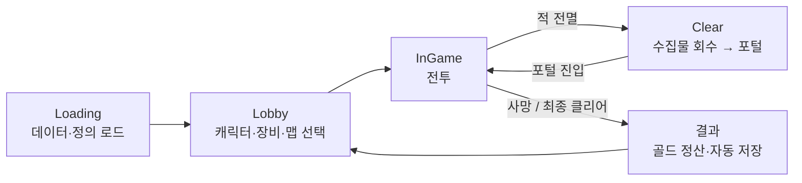
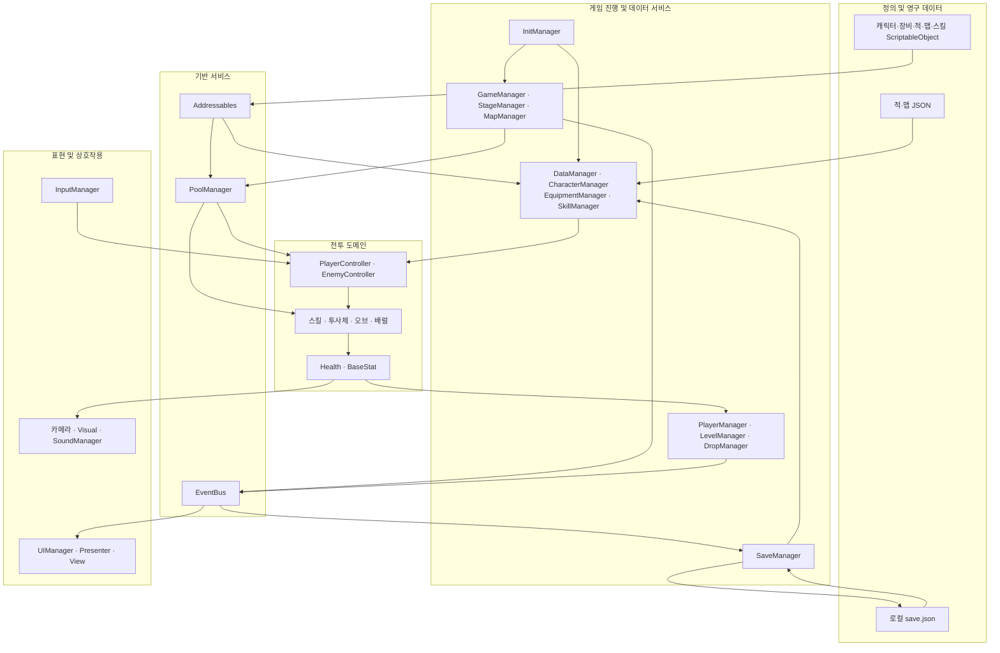
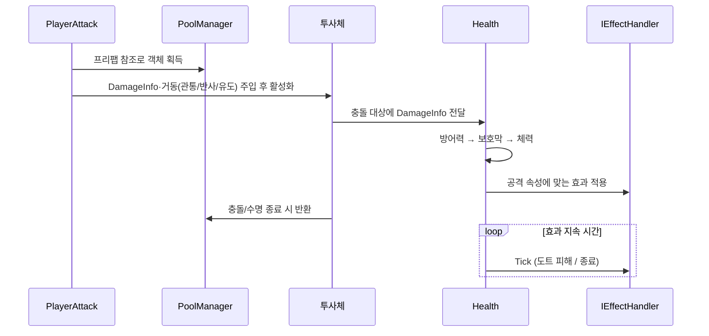

# 🏹 Archery

> Unity 6 기반 **3D 캐주얼 액션 로그라이트** 게임의 게임플레이 코드 저장소

> ⚠️ **이 저장소는 직접 작성한 C# 스크립트(`Assets/Scripts`)만 담고 있습니다.**
> 모델·애니메이션·프리팹·머티리얼·사운드 등 외부 에셋은 라이선스 문제로 포함하지 않았기 때문에, 클론만으로는 Unity에서 실행되지 않습니다.
> 사용한 외부 에셋의 출처는 [UNITY_IMPORTED_ASSETS.md](./UNITY_IMPORTED_ASSETS.md)에 정리했습니다.
> 실행 모습은 아래 플레이 영상으로 확인할 수 있습니다.

---

## 🎬 플레이 영상

[

---

## 🎮 게임 소개

플레이어는 **이동으로 적의 공격을 피하고, 멈춰 있을 때 자동으로 공격**합니다.
적을 처치해 경험치와 골드를 얻고, 레벨업 때 제시되는 **스킬 3택 1**로 그 회차의 전투 능력을 만들어 갑니다.
로비에서는 캐릭터와 장비를 구매·선택·강화하며, 이 **영구 성장은 회차별 임시 성장과 분리**되어 있습니다.



---

## 🧭 설계 목표

| 목표 | 내용 |
|------|------|
| 🧩 **행동과 데이터의 분리** | 캐릭터·적·맵·스킬·장비의 정의와 실행 로직을 분리해 콘텐츠 조정 범위를 제한 |
| ♻️ **전투 객체 재사용** | 적, 투사체, 드롭 아이템, 효과, 맵 프리팹을 풀에서 재사용 |
| 🚦 **진행의 명시적 제어** | 스테이지 상태, 전투 개체 상태, UI 모달 상태를 구분해 전환 책임을 관리 |
| 💾 **성장의 분리** | 구매·장착·강화는 보존하고, 회차 경험치·스킬·버프는 별도 수명으로 관리 |
| 📣 **변경 통지의 분리** | 전역 이벤트와 개체별 이벤트로 게임 진행·UI·저장·시각 효과를 연결 |

---

## 🛠 기술 스택

| 영역 | 기술 |
|------|------|
| 🎮 엔진 | Unity 6 (`6000.0.62f1`), URP |
| 💻 언어 | C# (`MonoBehaviour` 컴포넌트, Unity 생명주기) |
| ⚡ 비동기 | Unity `Awaitable`, Addressables `Task`, 파괴 취소 토큰 |
| 📦 리소스 | Addressables (라벨 기반 정의 로딩, AssetReference 프리팹 로딩) |
| 📄 데이터 | ScriptableObject, TextAsset JSON, Newtonsoft.Json, 로컬 `save.json` |
| 🕹️ 입력 | Unity Input System (이동) + 일부 `KeyCode` 메뉴 입력 |
| 🖼️ UI | Unity UI, TextMesh Pro |
| 🎯 물리·연출 | 3D Rigidbody·Collider, Animator, ParticleSystem |

---

## 🏗 아키텍처

책임별 **매니저 서비스**와 **컴포넌트 기반 게임 객체**를 결합한 구조입니다.
계층은 이해를 위한 책임 구획이며, 모든 의존성이 인터페이스로 역전된 엄격한 계층형 구조는 아닙니다.



---

## ⚙️ 핵심 시스템

### 1️⃣ 매니저와 초기화 · EventBus

- 전역 서비스는 **Singleton + `DontDestroyOnLoad`** 로 두고, 스테이지·카메라처럼 씬에 종속된 책임은 별도 컴포넌트로 운영합니다.
- Loading 씬의 `InitManager`가 JSON·플레이어 데이터 → 맵 → 캐릭터 → 장비 → 오브 → 배럴 → 스킬 정의 순으로 **비동기 초기화**한 뒤 로비로 진입합니다.
- `EventBus`는 우선순위가 작은 구독자부터 **동기 실행**하고, 발행 시 구독 목록의 스냅샷을 사용합니다. 전역 이벤트는 페이로드 없이 사건 종류만 전달하며, 수신자가 필요한 정보를 해당 매니저에서 조회합니다.

### 2️⃣ 데이터 모델과 3계층 스탯

콘텐츠의 정적 정의(ScriptableObject·JSON), 플레이어의 영구 상태, 전투 중 실행 상태를 구분합니다.

플레이어 능력치는 세 계층의 합성입니다.

```
최종 능력치 = Base(캐릭터 기본 + 영구 레벨 성장)
           + Equipment(무기·방어구·신발의 종류별 레벨 보정)
           + InGameBuff(해당 회차에 획득한 스킬의 임시 보정)
```

- 공격 속성은 각 계층의 **비트 플래그**를 결합합니다.
- 임시 보정은 속성·스킬 출처별로 보관해 같은 스킬의 갱신과 서로 다른 스킬의 합성을 구분합니다.
- 적은 공통 `BaseStat` 계약을 쓰되, `EnemyStatUtil`이 적 기본 데이터 × 맵 배율 × 스테이지 성장 배율을 결합합니다.

### 3️⃣ Addressables와 오브젝트 풀링

- **정의 로딩**: `map_config`, `character_identity`, `equipment_identity`, `skill_config`, `orb_config`, `barrel_config` 라벨 단위로 로드해 사전에 캐시합니다.
- **프리팹 풀링**: `AssetReference`의 **GUID** 기준으로 `PoolManager`가 풀을 관리합니다. 같은 GUID의 동시 요청은 로드 핸들을 공유하고, 사용이 끝난 객체는 비활성화해 원래 풀로 반환합니다.
- 재사용 객체는 개체별 초기화 과정에서 이전 사용 상태(타격 기록, 행동 상태, 획득 상태 등)를 정리합니다.
- 모든 객체가 풀링되는 것은 아닙니다. (예: `GroundZone`은 일반 생성·파괴 수명을 사용)

### 4️⃣ 맵 · 스테이지 진행

`StageManager`가 **상태 × 명령 전이 테이블**로 진행을 제어합니다.

| 상태 | 명령 | 다음 상태 |
|------|------|-----------|
| Loading | LoadingComplete | Combat |
| Combat | AllEnemiesDefeated | Clear |
| Clear | EnterPortal | Loading |

- 미리 제작된 맵을 데이터에 따라 선택·배치합니다. (절차적 지형 생성은 아닙니다)
- 일반 스테이지는 맵에 고정 배치된 적 + JSON의 적 수 설정에 따른 무작위 적, 보스 스테이지는 별도 보스 Identity를 사용합니다.
- 마지막 적 처치 후 수집물을 플레이어 쪽으로 회수하고, 수집물이 0이 되면 포털을 활성화합니다.

### 5️⃣ 플레이어 · 적 행동 제어

| | 플레이어 | 적 |
|---|---|---|
| 상태 | Idle · Move · Attack · Dead | Idle · Move · Attack · Hurt · Dead |
| 방식 | 상태 열거형 + 기능 컴포넌트(이동·공격·피격·스킬) 협력 | 상태별 `OnEnter` / `OnExit` / `Tick`을 **행동 모듈**에 위임 |
| 확장 | 컴포넌트 단위 | `EnemyBehaviorFactory`가 태그에 맞는 모듈을 구성 |

- 플레이어 공격은 Animator의 발사 이벤트가 현재 Attack 상태를 확인한 뒤 실행됩니다.
- 적은 추적·순찰·무작위 이동, 근접 공격, 직선·곡사 발사 등을 **조합**할 수 있고, 보스는 군중 제어(Ice·Lightning)에 면역입니다.

### 6️⃣ 스킬 시스템

- **정의(ScriptableObject)** 와 **실행 모듈(컴포넌트)** 을 분리합니다. 현재 스킬 정의 33종 / 구체 모듈 33종입니다.
- 레벨업 시 현재 스탯과 등장 조건을 만족하는 후보를 섞어 **최대 3개**를 제시합니다.
- 신규 스킬은 `SkillDefinition`에 지정된 타입을 **리플렉션**으로 찾아 컴포넌트를 추가·초기화하고, 보유 스킬은 레벨을 올립니다(최대 레벨은 후보에서 제외).
- 속성 부여 스킬은 타고난 속성 기준, 속성 강화 스킬은 회차 버프까지 포함한 실제 속성 기준으로 등장합니다.

### 7️⃣ 공격 · 피해 · 상태이상



- 공격 객체는 `IDamageable` + `DamageInfo`만 알면 되므로 투사체·오브·배럴·장판이 **공통 `Health`** 를 사용합니다.
- 상태이상은 `IEffectHandler`(Apply·Tick) 전략으로 분리합니다.

| 효과 | 동작 |
|------|------|
| 🔥 Fire / ☠️ Poison | 지속 시간·틱 간격 관리, 마법 저항을 반영한 도트 피해 |
| ❄️ Ice | 효과 강도 조정, 이동·애니메이션 감속 |
| ⚡ Lightning | `IStunReceiver`로 행동 중단·복귀 요청 |

### 8️⃣ 보상 · 성장 · 저장

- **보상**: 적 처치 → 드롭 생성 → 수집(자석) → 경험치는 `LevelManager`, 골드는 회차 골드로 누적. 사망·맵 클리어 시 회차 골드를 영구 골드로 **한 번만** 합산합니다. (정산 우선순위 50 → 자동 저장 100)
- **영구 성장**: 캐릭터별 영구 레벨, 장비 소유 목록, 종류별(Weapon · Armor · Shoes) 장착과 공유 레벨. 장비 교체는 다음 캐릭터 생성 시 전투 스탯에 반영됩니다.
- **저장**: `Application.persistentDataPath/save.json` + `save.json.bak` 백업. 구매·강화·장착·설정 변경, 사망·클리어·로비 전환, 앱 종료·일시정지 시점에 자동 저장됩니다. (회차 중 이어하기용 전투 상태 저장은 아닙니다)

### 9️⃣ UI · 표현

- **UI**: View(표시)와 Presenter(조작 해석)를 분리하고, `UIManager`가 게임 이벤트(LevelUp, PlayerDied, MapCleared 등)와 팝업 생성을 연결합니다. 로비 탭·스킬 선택·결과·일시정지 화면에 적용했습니다.
- **카메라**: 속도 기반 시선 선행과 축별 부드러운 추적, 로비의 RenderTexture 캐릭터 미리보기.
- **시각 피드백**: `Health` 이벤트를 받아 상태이상 재질 발광, 빌보드 체력바를 갱신합니다.
- **사운드**: `SoundManager`가 씬·맵·`SfxType`에 따라 BGM·SFX를 선택합니다.

### 🔟 에디터 · 빌드 도구

- `NameRegistry` + `PropertyDrawer`로 식별자를 Inspector 선택지로 제공
- 적 체력바 일괄 추가 등 반복 작업 자동화, 저장 파일 점검 메뉴
- 스킬 정의 동기화 → Addressables 빌드 → Windows 플레이어 빌드 절차

---

## 🧱 사용한 설계 패턴

| 패턴 | 적용 영역 |
|------|-----------|
| Singleton | 책임별 매니저 |
| State / 상태 기반 제어 | 플레이어·적 행동, 스테이지 진행 |
| Strategy | `IEffectHandler`, 적 이동·공격 모듈 |
| Factory + Registry | `EnemyBehaviorFactory` |
| Observer / Pub–Sub | `EventBus`, `Health` 이벤트 |
| MVP 지향 역할 분리 | 로비 탭, 스킬 선택, 결과·일시정지 UI |
| Object Pool | `PoolManager`, `SceneObject` 계열 |
| 데이터 주도 구성 | ScriptableObject, JSON |
| 리플렉션 기반 연결 | `SkillDefinition` → 스킬 모듈 |
| 컴포넌트 조합 | 플레이어·적의 이동·공격·피격·시각 요소 |

---

## 📂 코드 구조

```
Assets/Scripts/
├── Managers/        # 초기화·진행·데이터·풀링·저장·사운드 등 매니저
├── Players/         # 플레이어 컴포넌트, 스킬 모듈
├── Enemy/           # 적 컨트롤러와 행동 모듈
├── Map/             # 맵·스테이지 구성
├── Objects/         # 투사체, 오브, 배럴, 드롭 아이템, 포털
├── Stats/           # BaseStat · PlayerStat · EffectData
├── Effects/         # 상태이상 핸들러
├── UI/              # 로비·인게임 View / Presenter
├── SaveSystem/      # SaveData
├── Camera/          # 전투·로비 카메라
├── Utils/           # EventBus 등 유틸리티
└── Editor/          # 콘텐츠 저작 도구
```

---

## 🔍 구현 범위와 한계

- 설치된 패키지와 실제 구현은 별개입니다. (예: Entities 패키지가 있어도 ECS 전투를 구현한 것은 아닙니다)
- 프레임 속도·메모리 절감량·로딩 시간 같은 **실측하지 않은 성능 수치는 제시하지 않습니다.**
- UI는 MVP 지향 분리 + 이벤트 + 프레임 폴링이 혼합되어 있습니다.
- 확장성은 "무수정 확장"이 아니라, 기존 규칙 안의 콘텐츠 변화는 데이터·프리팹 연결로, 새 알고리즘·상태 계약은 해당 책임의 코드로 제한하는 데 있습니다.

---

## 📚 문서

전체 구현 근거와 시스템별 상세 설명은 **[ARCHERY_SYSTEM_ARCHITECTURE.md](./ARCHERY_SYSTEM_ARCHITECTURE.md)** 에 있습니다.

## 📄 라이선스

[MIT License](./LICENSE) — 코드에만 적용되며, 외부 에셋은 각 제작사의 라이선스를 따릅니다.
